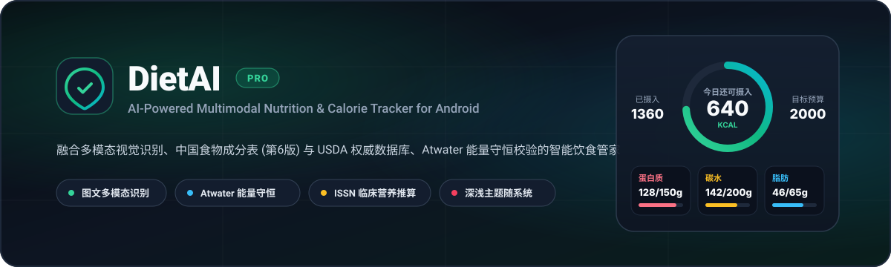
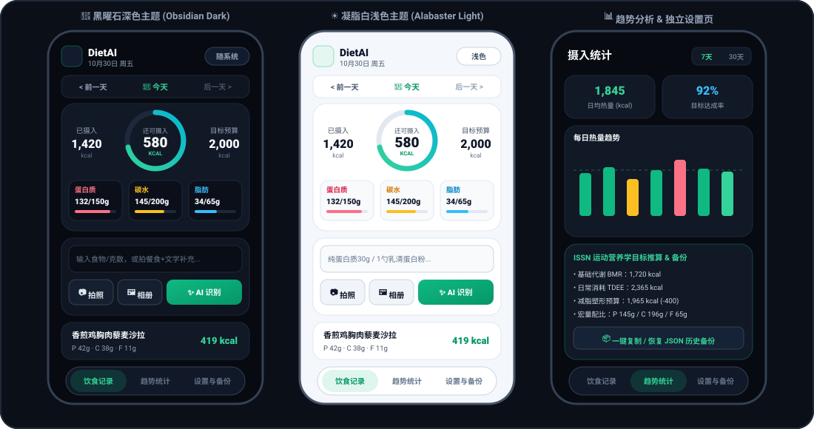
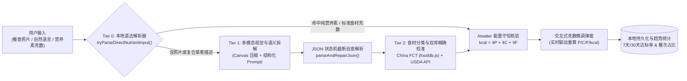

<div align="center">



<br />

# 🥗 DietAI — 智能饮食营养与热量管家

**AI-Powered Multimodal Nutrition & Calorie Tracker for Android**

[](https://github.com/Lyylovelove/diet-ai/actions)
[](https://github.com/Lyylovelove/diet-ai/releases/latest)
[-3DDC84?style=flat-square&logo=android&logoColor=white)](https://github.com/Lyylovelove/diet-ai)
[](https://fdc.nal.usda.gov/)
[](LICENSE)

[**📥 下载最新安装包 (APK)**](https://github.com/Lyylovelove/diet-ai/releases/latest) · [**✨ 核心特性**](#-核心特性) · [**📱 界面预览**](#-界面预览) · [**🧠 算法与架构**](#-营养解析与能量守恒架构) · [**🛠️ 本地构建**](#️-开发与构建指南) · [**📋 更新日志**](CHANGELOG.md)

</div>

---

## 📖 项目简介

**DietAI** 是一款专为健身减脂、增肌塑形与日常控卡人群打造的 **Android 智能饮食营养追踪应用**。

针对传统饮食记录软件「手动搜库繁琐」与纯大模型估算「热量幻觉严重、宏量营养素与总热量不自洽」的痛点，DietAI 构建了 **「本地零延迟正则直通 + 多模态视觉拆解 + 中国食物成分表/USDA 双库精确校准 + Atwater 能量守恒强校验」** 的四级混合营养引擎，并针对 **Samsung One UI / Android 14** 进行了原生级深浅色主题联动适配。

---

## 📱 界面预览

<div align="center">
  
</div>

---

## ✨ 核心特性

### 1. 🍱 图文多模态混合输入 (Unified Multimodal Composer)
- **拍照 / 相册 + 文字补充同一入口**：支持在拍摄餐食照片后附加文字说明（如 *「只吃了一半」「去皮鸡腿，米饭150g」「少油水煮」*），图像经本地 Canvas 智能压缩后与文本一并送入多模态模型联合推理。
- **纯营养素与补剂秒级直通**：针对健身人群高频输入的 `纯蛋白质30g`、`1勺乳清蛋白粉`、`碳水45g 蛋白质25g`、`鸡胸肉150g + 鸡蛋2个` 等结构化文本，内置本地语法解析器 **0 毫秒直出结果**，无需等待网络请求。

### 2. ⚖️ 四级营养校准与 Atwater 能量守恒引擎
- **内置《中国食物成分表 (第6版)》与黄金标准字典**：离线内置 1,200+ 条常见中式食材与标准熟食每 100g 营养基准值（[`fooddb.js`](app/src/main/assets/fooddb.js) + `STANDARD_FOODS`），支持 **USDA FoodData Central API** 在线回退。
- **严格精确匹配，零模糊匹配幻觉**：仅对单一基础食材（`category: "raw"`）执行精确字典映射，彻底杜绝传统二元分词模糊匹配将复合菜肴误映射至高脂食材的问题。
- **隐形烹调油防幻觉过滤**：当用户输入非炒菜类食物（如米饭、鸡蛋、牛奶、水果、白灼/清蒸食材）且未主动提及油脂时，自动拦截并剔除大模型虚构的 `花生油 / 食用油` 条目。
- **Atwater 能量守恒定律强校验**：对每一项食材及整餐汇总强制执行热力学能量守恒核验：
  $$\text{Calories (kcal)} = 4 \times \text{Protein (g)} + 4 \times \text{Carbs (g)} + 9 \times \text{Fat (g)}$$
  支持在识别结果页实时修改任意食材克数，全餐热量与三大营养素按比例毫秒级重算。

### 3. 🧬 ISSN 运动营养学临床目标推算
- 基于 **Mifflin-St Jeor 基础代谢方程** 计算个体 `BMR` 与日常消耗 `TDEE`：
  $$\text{BMR}_{\text{male}} = 10W + 6.25H - 5A + 5, \quad \text{BMR}_{\text{female}} = 10W + 6.25H - 5A - 161$$
- 结合 **国际运动营养学会 (ISSN)** 指南，按阶段目标（减脂塑形 `-400 kcal` / 保持健康体重 / 干净增肌 `+250 kcal`）与体重动态分配每公斤蛋白质（`1.6–2.0 g/kg`）、脂肪占比與碳水余量。

### 4. 🌓 原生级深色 / 浅色双主题自适应
- **默认跟随手机系统（One UI / Android Dark Mode）**：通过 [`MainActivity.java`](app/src/main/java/com/dietai/app/MainActivity.java) 监听系统 `Configuration.UI_MODE_NIGHT_MASK` 变化，实时同步原生状态栏、底部导航栏与 WebView CSS 变量（**黑曜石深色 Obsidian Dark** / **凝脂白浅色 Alabaster Light**），并支持顶栏一键切换。

### 5. 📅 历史日期穿梭、补录与全量 JSON 备份
- **任意历史日期查看与补录**：顶栏日期胶囊支持前后翻页与日历选日，无论是 AI 识别还是手动快录，均自动归档至当前选中日期。
- **固定签名无缝覆盖升级 + JSON 备份恢复**：采用固定签名证书配置，新版本 APK 可直接覆盖安装并完整保留 `localStorage` 历史数据；同时提供一键导出/粘贴合并 JSON 备份。

---

## 🧠 营养解析与能量守恒架构



---

## 📂 项目目录结构

```text
diet-ai/
├── .github/
│   ├── ISSUE_TEMPLATE/             # 标准 Issue 报告与功能请求模板
│   └── workflows/
│       └── build-apk.yml           # GitHub Actions 自动化编译、签名与 Release 发布流水线
├── app/
│   ├── build.gradle                # Android 模块构建配置 (minSdk 24, targetSdk 34)
│   └── src/main/
│       ├── AndroidManifest.xml     # 应用权限、FileProvider 与 uiMode 配置声明
│       ├── java/com/dietai/app/
│       │   └── MainActivity.java   # WebView 宿主容器、相机 FileProvider 桥接与系统深浅色同步
│       ├── assets/
│       │   ├── index.html          # 单页三栏式应用视图结构 (记录 / 统计 / 设置与备份)
│       │   ├── styles.css          # Obsidian Dark & Alabaster Light 双主题响应式样式系统
│       │   ├── app.js              # 多模态识别、状态机 JSON 修复、Atwater 校验与图表引擎
│       │   └── fooddb.js           # 离线《中国食物成分表》基准营养数据库 (1,200+ 条目)
│       └── res/                    # 矢量启动图标、主题资源与相机共享路径配置
├── docs/
│   ├── banner.svg                  # 项目横幅矢量图
│   └── ui-preview.svg              # 深色/浅色主题与统计页矢量预览图
├── build.gradle                    # 根项目 Gradle 配置
├── settings.gradle                 # 模块映射与仓库源声明
├── CHANGELOG.md                    # 版本迭代更新日志
├── CONTRIBUTING.md                 # 开发者贡献指南
└── LICENSE                         # MIT 开源许可证
```

---

## 🛠️ 开发与构建指南

### 环境要求
- **JDK**: Java 17 (推荐 Eclipse Temurin 17)
- **Android SDK**: `compileSdk 34` / `minSdk 24` (Android 7.0+)
- **Gradle**: `8.2.1+`

### 1. 克隆仓库
```bash
git clone https://github.com/Lyylovelove/diet-ai.git
cd diet-ai
```

### 2. 本地编译 APK
```bash
# Linux / macOS
./gradlew assembleDebug

# Windows PowerShell
gradle assembleDebug
```
编译产物位于 `app/build/outputs/apk/debug/app-debug.apk`。

### 3. 配置 AI 接口密钥
1. 安装并打开 **DietAI**，点击底部导航栏右下角 **「设置与备份」**。
2. 在 **AI 接口配置** 中填入你的 API Key（支持 [DeepSeek Platform](https://platform.deepseek.com/) 或任意兼容 OpenAI Chat Completions 协议的多模态接口地址与模型名称）。
3. 在 **身体档案** 中输入身高、体重、年龄与阶段目标，点击 **「按运动营养学公式计算推荐目标」** 并保存即可开始使用。

---

## 📋 版本演进摘要

完整版本记录请参阅 [**CHANGELOG.md**](CHANGELOG.md)。

| 版本 | 发布重点 |
| :--- | :--- |
| **v17.1 (Marvel Edition)** | **漫威特别版 UI 主题**：新增斯塔克战甲红金配色、方舟反应堆电弧蓝流光圆环与 `STARK BIOMETRICS` HUD 遥测顶栏，支持四模式一键切换 |
| **v17.0 PRO** | 修复 Android 启动器 `category.LAUNCHER` 声明，完善三栏独立设置页与深浅色主题联动 |
| **v16.0 PRO** | 移除模态设置弹窗与顶栏冗余按钮，重构「设置与备份」为底部导航栏独立全屏页面 |
| **v15.0 PRO** | 新增 Android 原生状态栏 + WebView 双端系统深浅色自动跟随引擎与顶栏一键切换 |
| **v14.0 PRO** | 引入状态机 JSON 截断自愈解析器，升级黑曜石 Bento 座舱布局与全矢量 SVG 图标系统 |
| **v13.0 PRO** | 支持图文混合输入、纯营养素零延迟直录、Atwater 能量守恒校验、历史日期切换与 JSON 备份 |

---

## 🤝 贡献与反馈

欢迎提交 Issue 或 Pull Request 共同完善 DietAI！在提交代码前请阅读 [**CONTRIBUTING.md**](CONTRIBUTING.md)。

## 📄 开源许可

本项目基于 [**MIT License**](LICENSE) 开源。
